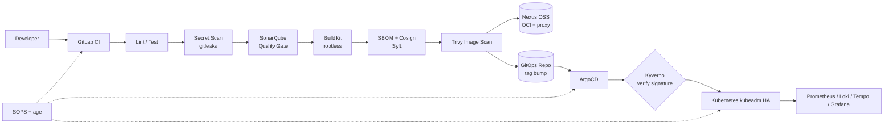

# gatezero-platform

**Zero-Trust Software Supply Chain** — dari `git push` sampai production, setiap artifact di-scan,
di-sign, dan di-verify sebelum boleh berjalan di cluster.

> Portofolio **Platform Engineering / DevSecOps**.
> Fondasi: Nutanix AHV → Kubernetes `kubeadm` HA → GitLab self-managed → Nexus OSS → SonarQube
> → ArgoCD → SOPS.

---

## 1. Prinsip

1. **Pull-based GitOps.** CI tidak pernah `kubectl apply`. CI hanya commit tag image ke repo
   GitOps; ArgoCD yang menarik dan menerapkan.
2. **Fail-closed.** Quality gate SonarQube, Trivy, dan signature Cosign bersifat *blocking*.
3. **Stateful berat di luar cluster.** SonarQube & Nexus berjalan di VM sendiri (Docker Compose).
4. **Secret tidak pernah plaintext.** SOPS + age sejak bootstrap kubeadm.
5. **Compliance as code.** Temuan CIS diremediasi lewat policy/kode, bukan tiket manual.

## 2. Arsitektur



Diagram detail: [`docs/architecture.drawio`](docs/architecture.drawio).

## 3. Stack

| Layer | Komponen | Catatan |
|---|---|---|
| Compute | Nutanix AHV | 3 control plane + 3 worker |
| Orchestrator | **kubeadm** HA (stacked etcd) | bukan k3s — CIS benchmark relevan penuh |
| CNI | **Cilium** | menggantikan kube-proxy, MetalLB, Traefik |
| Ingress | Gateway API + cert-manager | TLS wildcard via DNS-01 |
| CI | GitLab CE (self-managed) + Runner | kubernetes executor, rootless BuildKit |
| Artifact | **Nexus Repository OSS** | OCI hosted + proxy npm/maven/pypi/k8s |
| Quality | SonarQube + Semgrep | gate blocking |
| Supply chain | Trivy, Syft, **Cosign** (keyless) | SBOM + signature |
| GitOps | **ArgoCD** + ApplicationSet + Rollouts | app-of-apps, canary |
| Secrets | **SOPS + age** | hierarki 4 level |
| Policy | **Kyverno** + Pod Security Admission | verify signature, deny `:latest` |
| Runtime | Tetragon / Falco, Trivy Operator, Kubescape | eBPF + posture |
| Observability | kube-prometheus-stack, Alloy, Loki, Tempo | SLO + DORA |

## 4. Roadmap

> **Checklist eksekusi lengkap** — per item, dengan acceptance criteria, dependency,
> estimasi, dan Definition of Done:
> **[`ROADMAP.md`](ROADMAP.md)**
>
> Ringkasnya: repo ini sudah lengkap sebagai *blueprint* (dokumentasi + otomasi),
> tetapi belum ada kode aplikasi, pipeline nyata, manifest GitOps, atau cluster yang berjalan.

| Fase | Isi | Status |
|---|---|---|
| 0 | Foundation: VM, hardening OS, kubeadm HA, Cilium | ⬜ |
| 1 | GitLab hardening + Runner in-cluster | ⬜ |
| 2 | Nexus OSS sebagai artifact hub | ⬜ |
| 3 | CI pipeline 9 stage (fail-closed) | ⬜ |
| 4 | SOPS: hierarki key, rotasi, CMP ArgoCD | ⬜ |
| 5 | GitOps app-of-apps + Argo Rollouts | ⬜ |
| 6 | Security: Cosign, Kyverno, Tetragon, Kubescape | ⬜ |
| 7 | Observability + SLO + benchmark compliance | ⬜ |

## 5. Struktur Repo

```
apps/                 aplikasi demo (Go, distroless)
platform/bootstrap/   kubeadm, Cilium, cert-manager (idempoten)
platform/gitops/      ArgoCD app-of-apps + overlay per environment + .sops.yaml
platform/charts/      helm chart internal
ci/                   template CI reusable + script bantu
security/             Kyverno policy, Trivy ignorefile, threat model
docs/                 ADR, runbook, diagram
tests/                unit, integration, load test (k6)
```

## 6. Mulai

```bash
# prasyarat: docker, kubectl, helm, sops, age, pre-commit, just (opsional)
make install-hooks     # pasang pre-commit hook
make help              # daftar target
```

## 7. Demo Drills

Lima skenario yang didemokan ulang dalam <5 menit:

1. Commit berisi `AKIA...` → pipeline mati di stage secret-scan.
2. Tambah dependency CVE → Trivy gate gagal → Renovate PR → hijau.
3. Deploy image `:latest` tanpa signature → ditolak Kyverno.
4. `kubectl delete pod` di prod → self-heal + PDB, SLO tidak turun.
5. Error rate naik di staging → Argo Rollouts auto-rollback.

## 8. Keputusan Arsitektur

Semua keputusan besar terdokumentasi sebagai ADR: [`docs/adr/`](docs/adr/).

## 9. Lisensi

MIT (kecuali disebutkan lain).
